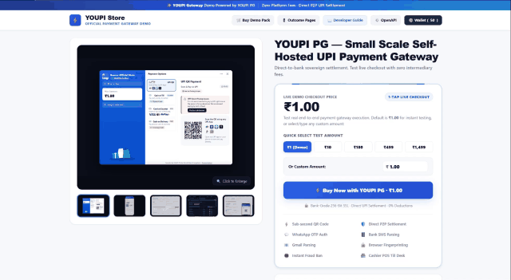
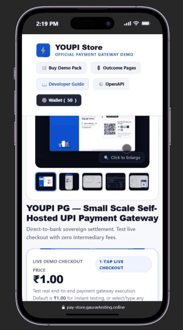
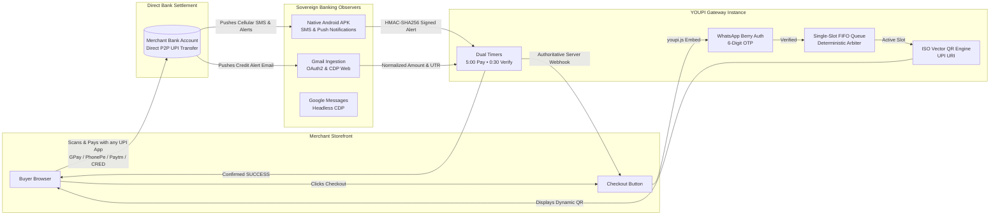

<div align="center">

```
██╗   ██╗ ██████╗ ██╗   ██╗██████╗ ██╗    ██████╗  ██████╗ 
╚██╗ ██╔╝██╔═══██╗██║   ██║██╔══██╗██║    ██╔══██╗██╔════╝ 
 ╚████╔╝ ██║   ██║██║   ██║██████╔╝██║    ██████╔╝██║  ███╗
  ╚██╔╝  ██║   ██║██║   ██║██╔═══╝ ██║    ██╔═══╝ ██║   ██║
   ██║   ╚██████╔╝╚██████╔╝██║     ██║    ██║     ╚██████╔╝
   ╚═╝    ╚═════╝  ╚═════╝ ╚═╝     ╚═╝    ╚═╝      ╚═════╝ 
```

# ⚡ YOUPI PG V2

### The Sovereign, Self-Hosted UPI Payment Gateway for Independent Merchants
**0% Gateway Fees • Direct-to-Bank Settlement • WhatsApp Pre-Checkout OTP • Bank SMS & Gmail Observers**

<br/>

[](https://nodejs.org)
[](#)
[](#)
[](#)
[](#)
[](#)
[-success?style=for-the-badge&logo=vitest&logoColor=white)](#)
[](#)

<br/>

<p align="center">
  <a href="#-live-product-demos">Live Demos</a> •
  <a href="#-the-problem-vs-the-youpi-solution">Why YOUPI?</a> •
  <a href="#-architecture-at-a-glance">Architecture</a> •
  <a href="#-key-features--superpowers">Superpowers</a> •
  <a href="#-quickstart-in-60-seconds">Quickstart</a> •
  <a href="#-universal-merchant-integration">Merchant Integration</a> •
  <a href="#-tri-channel-observation-mesh">Banking Observers</a> •
  <a href="#-port-topology">Port Topology</a> •
  <a href="#-documentation-hub">Docs</a>
</p>

---

</div>

<br/>

## 🎬 Live Product Demos

See **YOUPI PG V2** live in action across Desktop and Mobile checkout flows:

| 🖥️ Desktop Modal Flow | 📱 Mobile Drawer & App Switcher |
| :---: | :---: |
| <br/><sub>*Full end-to-end checkout: One-script modal, WhatsApp OTP, dynamic vector QR & bank observation.*</sub> | <br/><sub>*Ultra-responsive bottom drawer with 1-tap deep-link intent for GPay, PhonePe, Paytm & CRED.*</sub> |
| • **Zero-JS One-Script Trigger**: Auto-binds to `[data-youpi-pay]`<br/>• **WhatsApp Pre-Checkout OTP**: Real-time 6-digit phone verification<br/>• **Dynamic Vector SVG QR**: Pure vector QR code with dual timers<br/>• **Automated Observer Credit**: Instant credit via bank SMS/Gmail | • **Responsive Bottom Drawer**: Native app-feel mobile UI<br/>• **Direct UPI App Deep-Linking**: GPay, PhonePe, Paytm, CRED<br/>• **Real-Time Payment Polling**: Instant status reflection<br/>• **Counter Desk Modalities**: Configurable Cash & Card fallback |

<br/>

> **High-Definition 120FPS Raw Recordings**: [assets/Desktop.mp4](assets/Desktop.mp4) • [assets/Mobile.mp4](assets/Mobile.mp4)

<br/>

---

## 💡 Stop Paying 2–3% + 18% GST to Payment Aggregators

Traditional payment gateways (Razorpay, Cashfree, PayU, Stripe) lock your revenue into high fees, multi-day settlement delays, and sudden compliance freezes:

| Comparison Metric | Traditional Aggregators (Razorpay / Cashfree) | ⚡ YOUPI PG (Self-Hosted Sovereign) |
| :--- | :--- | :--- |
| **Transaction Fee** | **2.0% – 3.0% + 18% GST** per transaction | **0.0% (Zero Fees Forever)** |
| **Settlement Speed** | **T+2 to T+3 Business Days** (Holdbacks) | **Instant (Direct into your Bank Account)** |
| **Account Freeze Risk** | **High** (Unilateral freezes at aggregator discretion) | **ZERO** (You control your own VPA & infrastructure) |
| **Customer Authentication** | SMS OTP (Costly SMS gateway bills, phone spoofing) | **WhatsApp OTP** (Zero spoofing, verified mobile) |
| **Payment Verification** | Aggregator proprietary webhooks | **Bank SMS & Gmail Alerts** parsed in real time |
| **Queue & Mismatch Prevention** | Aggregator pooled virtual accounts | **Invariant Single-Slot FIFO UPI Queue** |
| **Branding Control** | "Secured by Razorpay" badges mandatory | **100% White-Label** (Your brand, your domain, zero mentions) |
| **Offline Retail Till Desk** | Expensive add-ons / dedicated POS hardware | **Built-in POS Cash & Card at Till Billing Mode** |
| **Deployment Simplicity** | Proprietary SaaS lock-in | **Native Node.js host process** (Zero Docker mandatory) |

<br/>

---

## 🏗️ Architecture at a Glance

YOUPI PG converts your standard Indian personal or business UPI receiving accounts into an automated, zero-fee payment gateway by coupling **pure vector SVG QR codes** with an **automated multi-channel banking observation mesh**.



<br/>

---

## 🚀 Key Features & Superpowers

### 1. ⚡ 0% Transaction Fees Forever
Every rupee paid goes straight from your customer's bank account to your bank account via standard NPCI UPI rails. No intermediaries hold your money.

### 2. 💬 WhatsApp Pre-Checkout Authentication (Berry Protocol)
No more fake orders, bot spam, or fraudulent phone numbers. Before a customer can enter the checkout queue, the gateway delivers a cryptographically random 6-digit OTP directly to their WhatsApp app using the embedded Baileys/Berry Protocol socket. Verified customer profiles are remembered in browser `localStorage`.

### 3. 🔒 Deterministic Single-Slot FIFO Queue Engine
Because standard UPI alerts do not carry arbitrary merchant metadata, multiple concurrent transactions with identical amounts could create attribution confusion. YOUPI PG solves this with a mathematical invariant:
- **Only ONE customer can pay on a VPA at a time.**
- Other buyers wait in a database-backed FIFO queue with live position streaming.
- Guarantees **100% exact payment matching** with zero payment mismatch errors!

### 4. 📱 Native Android Observer APK (`com.youpi.observer`)
A lightweight, battery-optimized Android foreground service that captures:
- Cellular banking SMS (`android.provider.Telephony.SMS_RECEIVED`).
- Real-time bank push notifications via `NotificationListenerService`.
- Enrolls securely via ephemeral QR code and signs all observation payloads with **HMAC-SHA256**.

### 5. 📧 Automated Gmail & Google Messages Ingestion
Dual backup observation channels:
- **Gmail Observer (Port 6003):** Polls Google Cloud OAuth2 API or automated headless Chrome CDP inbox monitoring.
- **SMS Observer (Port 6002):** Connects to Google Messages for Web via Chrome DevTools Protocol (CDP).

### 6. 🏪 Dual Operational Modalities
- **Online Selling Mode:** UPI Vector QR + Cash on Delivery (COD) with customer pre-purchase verification and decoupled address lifecycle.
- **Offline Store Counter Mode:** Designed for physical retail stores. Supports UPI QR, Cash at Till (`CASH_COUNTER`), and Card at POS Terminal (`CARD_COUNTER`) with an interactive real-time cashier till dock and instant SSE customer approval.

### 7. 🎨 100% White-Label Customizer
Rebrand the checkout portal completely through the Merchant Admin Panel:
- Custom app name, logo URL, and browser favicon.
- Tailored color palettes, custom gradients, and trust badges.
- Custom domain binding via Cloudflare Tunnels (`pay.yourbrand.com`).
- Complete removal of any "Powered by YouPI PG" attribution.

### 8. 🚦 5 Standardized Merchant Outcome Pages
Never leave customers hanging with blank screens or 404 errors:
- `/order-success` — Payment verified by observers, order marked paid and provisioned.
- `/order-failed` — Verification timed out, reassuring customer no money was lost.
- `/order-suspicious` — Flagged by fraud heuristics, held for manual compliance review.
- `/order-expired` — 5-minute session elapsed, slot released for queued customers.
- `/order-cancelled` — Customer cancelled checkout session.

<br/>

---

## ⚡ Quickstart in 60 Seconds

### Prerequisites
- **Node.js `>= 20.0.0` LTS** (`node -v`)
- Standard Linux or Windows host
- *No Docker or external database services required!*

### 1. Clone & Install Dependencies
Standard `npm install` works out-of-the-box across all packages and apps without any protocol issues:
```bash
git clone https://github.com/gxurav1710/YouPI-PG---Self-hosted-UPI-payment-gateway-.git youpi-pg
cd youpi-pg
npm install
```

### 2. Configure Environment
```bash
cp .env.example .env
```
*(The default `.env` is pre-configured for localhost out of the box).*

### 3. Zero-Config Launch (Auto-Initialized SQLite)
On first launch, YOUPI PG automatically provisions `data/youpi_pg.sqlite`, creates the directory if missing, and executes idempotent migrations and baseline seeds. No manual database setup is required:
```bash
npm run dev
# or
npm start
```

That's it! Your entire gateway cluster will spin up:
- 🎛️ **Control Center Supervisor:** [`http://localhost:8090`](http://localhost:8090)
- 📊 **Merchant Admin Panel:** [`http://localhost:6001`](http://localhost:6001)
- 🛒 **YOUPI Showcase Demo Store:** [`http://localhost:5000`](http://localhost:5000)
- ⚡ **Payment REST API:** [`http://localhost:6100`](http://localhost:6100)
- 💳 **Customer Checkout Portal:** [`http://localhost:7000`](http://localhost:7000)

### 4. Run the Full Regression Test Suite
Verify all **31 test suites** across packages, apps, and chaos harnesses:
```bash
npm test
```
```text
============================================================
🧪 YOUPI PG V2 — FULL REGRESSION TEST RUNNER
Running 31 curated test suites...
============================================================
[1/31] Testing packages/common/src/__tests__/common.test.js... ✅ PASS (0.22s)
...
[31/31] Testing scripts/production-infrastructure.test.js... ✅ PASS (0.17s)
============================================================
🎉 ALL 31 TEST SUITES PASSED CLEANLY (Total: 17.68s)
============================================================
```

<br/>

---

## 📦 Universal Merchant Integration

Integrating YOUPI PG into your website, web app, or e-commerce store takes less than 5 minutes.

### Step 1: Add the Universal Script to your `<head>`
```html
<!-- Official YOUPI PG Universal Integration Script -->
<script src="https://pay.yourdomain.com/youpi.js" 
        data-youpi-key="YOUR_MERCHANT_PUBLIC_KEY" 
        data-currency="INR">
</script>
```

### Step 2: Declarative Button (Zero JavaScript Required!)
Add `data-youpi-pay` attributes to any existing HTML button:
```html
<button data-youpi-pay
        data-order-id="ORDER-1001"
        data-amount="499.00"
        data-currency="INR">
  ⚡ Buy Now with YOUPI PG
</button>
```
*The script automatically intercepts the click, opens a centered desktop modal (or mobile slide-up bottom sheet), and launches the checkout session!*

### Step 3: Programmatic API (For React, Vue, Next.js, Nuxt)
```javascript
window.Youpi.pay({
  order_id: 'ORDER-1001',
  amount: 499.00,
  currency: 'INR',
  name: 'Acme Digital Store',
  description: 'Pro Subscription Top-Up',
  handler: function(response) {
    // response: { status: 'SUCCESS', order_id, amount_received, utr }
    console.log(`Payment confirmed! UTR: ${response.utr}`);
    window.location.href = `/order-success?order_id=${response.order_id}&utr=${response.utr}`;
  },
  onClose: function() {
    console.log('Customer closed payment modal');
  }
});
```

### Step 4: Authoritative Server-to-Server Webhook Verification
> ⚠️ **CRITICAL SECURITY RULE:** Never fulfill orders based solely on frontend browser events. Always verify the backend HMAC-SHA256 signature! Consumers **MUST** compute the HMAC over the raw, unparsed request bytes before any JSON parsing.

#### Webhook Contract:
- **Header**: `X-Gateway-Signature: sha256=<64_char_hex_hash>`
- **Additional Headers**: `X-Gateway-Event: SUCCESS`, `X-Gateway-Delivery-Id: <uuid>`, `X-Gateway-Timestamp: <timestamp_ms>`
- **Payload Fields**:
  - `event`: `'SUCCESS'`
  - `orderId`: Merchant order ID (string)
  - `amount`: Formatted amount in Rupees, e.g. `'499.00'`
  - `amountPaise`: Integer amount in Paise, e.g. `49900`
  - `utr`: 12-digit bank reference number
  - `paymentId`: Unique gateway payment session UUID

#### Polyglot Webhook Verification Snippets:

##### 1. Node.js (Express)
```javascript
import crypto from 'node:crypto';

app.post('/api/youpi-webhook', express.raw({ type: 'application/json' }), (req, res) => {
  const signature = req.headers['x-gateway-signature'] || '';
  const secret = process.env.YOUPI_WEBHOOK_SECRET;
  const expected = 'sha256=' + crypto.createHmac('sha256', secret).update(req.body).digest('hex');

  if (signature.length !== expected.length ||
      !crypto.timingSafeEqual(Buffer.from(signature), Buffer.from(expected))) {
    return res.status(401).json({ error: 'Invalid webhook signature' });
  }

  const payload = JSON.parse(req.body.toString('utf8'));
  if (payload.event === 'SUCCESS') {
    // Fulfill order: payload.orderId, payload.utr, payload.amount, payload.amountPaise
  }
  res.status(200).json({ received: true });
});
```

##### 2. Python (FastAPI)
```python
import hmac, hashlib, json
from fastapi import FastAPI, Request, HTTPException

app = FastAPI()

@app.post("/api/youpi-webhook")
async def youpi_webhook(request: Request):
    raw_body = await request.body()
    signature = request.headers.get("X-Gateway-Signature", "")
    secret = request.app.state.webhook_secret.encode("utf-8")

    expected = "sha256=" + hmac.new(secret, raw_body, hashlib.sha256).hexdigest()
    if not hmac.compare_digest(signature, expected):
        raise HTTPException(status_code=401, detail="Invalid webhook signature")

    payload = json.loads(raw_body.decode("utf-8"))
    if payload.get("event") == "SUCCESS":
        # Fulfill order: payload["orderId"], payload["utr"], payload["amount"]
        pass
    return {"received": True}
```

##### 3. PHP
```php
<?php
$rawPayload = file_get_contents('php://input');
$signature = $_SERVER['HTTP_X_GATEWAY_SIGNATURE'] ?? '';
$secret = getenv('YOUPI_WEBHOOK_SECRET');

$expected = 'sha256=' . hash_hmac('sha256', $rawPayload, $secret);

if (!hash_equals($expected, $signature)) {
    http_response_code(401);
    exit(json_encode(['error' => 'Invalid webhook signature']));
}

$payload = json_decode($rawPayload, true);
if (($payload['event'] ?? '') === 'SUCCESS') {
    // Fulfill order: $payload['orderId'], $payload['utr'], $payload['amount']
}

http_response_code(200);
echo json_encode(['received' => true]);
?>
```

##### 4. Go (`net/http`)
```go
package main

import (
	"crypto/hmac"
	"crypto/sha256"
	"encoding/hex"
	"encoding/json"
	"io"
	"net/http"
	"os"
)

func youpiWebhookHandler(w http.ResponseWriter, r *http.Request) {
	rawBody, err := io.ReadAll(r.Body)
	if err != nil {
		http.Error(w, "Cannot read body", http.StatusBadRequest)
		return
	}
	defer r.Body.Close()

	signature := r.Header.Get("X-Gateway-Signature")
	secret := []byte(os.Getenv("YOUPI_WEBHOOK_SECRET"))

	mac := hmac.New(sha256.New, secret)
	mac.Write(rawBody)
	expected := "sha256=" + hex.EncodeToString(mac.Sum(nil))

	if !hmac.Equal([]byte(signature), []byte(expected)) {
		http.Error(w, "Invalid webhook signature", http.StatusUnauthorized)
		return
	}

	var payload struct {
		Event       string `json:"event"`
		OrderId     string `json:"orderId"`
		UTR         string `json:"utr"`
		Amount      string `json:"amount"`
		AmountPaise int64  `json:"amountPaise"`
	}
	if err := json.Unmarshal(rawBody, &payload); err == nil && payload.Event == "SUCCESS" {
		// Fulfill order: payload.OrderId, payload.UTR, payload.Amount
	}

	w.WriteHeader(http.StatusOK)
	w.Write([]byte(`{"received":true}`))
}
```

<br/>

---

## 🔭 Tri-Channel Observation Mesh

YOUPI PG confirms payments without expensive commercial banking APIs using a triple-layer observation pipeline:

```text
              CUSTOMER SCANS & PAYS VIA UPI
                           │
                           ▼
                 RECEIVING BANK ACCOUNT
                           │
        ┌──────────────────┼──────────────────┐
        ▼                  ▼                  ▼
┌───────────────┐  ┌───────────────┐  ┌───────────────┐
│  CELLULAR SMS │  │   BANK PUSH   │  │  GMAIL CREDIT │
│  ALERT ON SIM │  │ NOTIFICATION  │  │  ALERT EMAIL  │
└───────┬───────┘  └───────┬───────┘  └───────┬───────┘
        │                  │                  │
        ▼                  ▼                  │
┌──────────────────────────────────┐          │
│    NATIVE ANDROID OBSERVER APK   │          │
│  com.youpi.observer (Foreground) │          │
│     HMAC-SHA256 Signed Payload   │          │
└─────────────────┬────────────────┘          │
                  │                           ▼
                  │                 ┌───────────────────┐
                  │                 │   GMAIL OBSERVER  │
                  │                 │ Google Cloud API  │
                  │                 └─────────┬─────────┘
                  │                           │
                  └─────────────┬─────────────┘
                                ▼
                   PAYMENT CORE REST ENGINE
               Exact Amount & UTR Normalization
                                │
                                ▼
                       SUCCESS CONFIRMED
```

1. **Android Observer App:** Install [`apps/android-observer-app/youpi-sms-gateway.apk`](apps/android-observer-app/youpi-sms-gateway.apk) on any secondary Android smartphone with the receiving bank SIM. Scan the pairing QR code in Merchant Admin to establish an encrypted HMAC link.
2. **Gmail Observer:** Connect your bank-registered Google account using standard OAuth2 credentials.
3. **Google Messages Web Observer:** Pairs via headless Chrome DevTools Protocol to observe cellular SMS through Google Messages Web.

<br/>

---

## 🌐 Port Topology & Microservices Map

| Service | Port | Directory | Entrypoint | Responsibility |
| :--- | :---: | :--- | :--- | :--- |
| **Payment API** | `6100` | [`apps/payment-api`](apps/payment-api) | `src/index.js` | Core REST API, state machine, DB transactions & SSE stream |
| **Checkout Portal** | `7000` | [`apps/checkout-portal`](apps/checkout-portal) | `src/index.js` | Customer iframe checkout, dynamic vector QR, SDK bundle |
| **Merchant Admin** | `6001` | [`apps/merchant-admin`](apps/merchant-admin) | `src/index.js` | Operations panel, till billing desk, branding customizer |
| **Showcase Store** | `5000` | [`apps/coin-wallet-store`](apps/coin-wallet-store) | `src/index.js` | Reference enterprise merchant PDP, 5 outcome demonstrations |
| **Control Center** | `8090` | [`apps/control-center`](apps/control-center) | `src/index.js` | Process supervisor for starting, stopping, and logging all services |
| **SMS Observer** | `6002` | [`apps/sms-observer`](apps/sms-observer) | `src/index.js` | Google Messages Web automation via Chrome CDP |
| **Gmail Observer** | `6003` | [`apps/gmail-observer`](apps/gmail-observer) | `src/index.js` | Gmail Web CDP automation & Google OAuth2 poller |
| **Android APK** | N/A | [`apps/android-observer-app`](apps/android-observer-app) | Android OS | Intercepts cellular banking SMS and notifications |

<br/>

---

## 🔒 Security & Reliability Architecture

- **64-Bit Integer Minor Units (Paise):** Financial values are strictly represented as integers (`49900` paise = ₹499.00). Floating-point rounding drift is mathematically impossible.
- **Server-Authoritative Timers:** Timers are calculated strictly from SQLite state timestamps. Client-side browser tampering cannot manipulate countdowns.
- **Anti-Replay Observation Protection:** Android observer payloads require HMAC signatures with timestamp drift verification ($< 60$ seconds).
- **Hardware & Browser Fingerprinting:** Buyers are fingerprinted on arrival. Fraudulent actors and abusive chargeback profiles are permanently banned instantly.
- **Write-Ahead Logging (WAL):** SQLite operates with `PRAGMA journal_mode = WAL; PRAGMA foreign_keys = ON;`, ensuring crash safety and concurrent read performance.

<br/>

---

## 📚 Documentation Hub

Deep-dive engineering manuals and operational runbooks are available in the [`/docs`](docs) directory:

| Document | Description |
| :--- | :--- |
| 📘 [`ARCHITECTURE.md`](ARCHITECTURE.md) | **Canonical System Architecture & Engineering Blueprint** |
| 🚀 [`docs/INSTALLATION.md`](docs/INSTALLATION.md) | Host installation, prerequisites & environment setup |
| ⚙️ [`docs/CONFIGURATION.md`](docs/CONFIGURATION.md) | Environment configuration variables & secret management |
| 📱 [`docs/ANDROID_MOBILE_APP.md`](docs/ANDROID_MOBILE_APP.md) | Native Android Kotlin Observer APK guide & permissions |
| 🔭 [`docs/OBSERVERS_SETUP.md`](docs/OBSERVERS_SETUP.md) | Complete setup for Gmail, Google Messages & Android |
| 💳 [`docs/MERCHANT_INTEGRATION.md`](docs/MERCHANT_INTEGRATION.md) | Full developer integration guide, SDK methods & webhooks |
| 🎨 [`docs/WHITE_LABEL.md`](docs/WHITE_LABEL.md) | White-label branding customizer, domains & Cloudflare |
| 🛠️ [`docs/OPERATIONS_TROUBLESHOOTING.md`](docs/OPERATIONS_TROUBLESHOOTING.md) | Production operations, logs, diagnostics & troubleshooting |
| 🌐 [`openapi.yaml`](openapi.yaml) | Official OpenAPI 3.0 REST API specification |

<br/>

---

## ⚖️ License

Distributed under commercial and sovereign licensing for independent merchant deployments. See [`LICENSE`](LICENSE) for full terms.

<br/>

<div align="center">

### Built for Financial Sovereignty in India 🇮🇳
**Take back control of your payments. Zero middleman fees. Direct settlement.**

⭐ **Star this repository if you believe in open, zero-fee payment infrastructure!**

</div>
